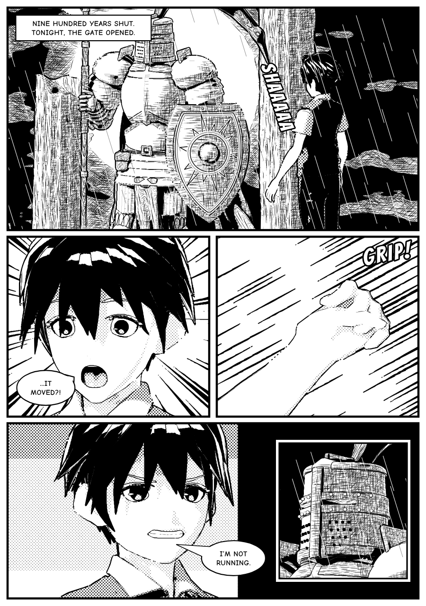
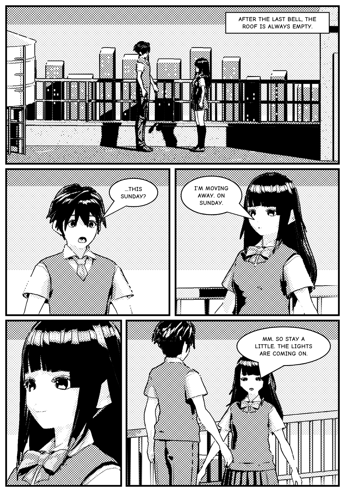
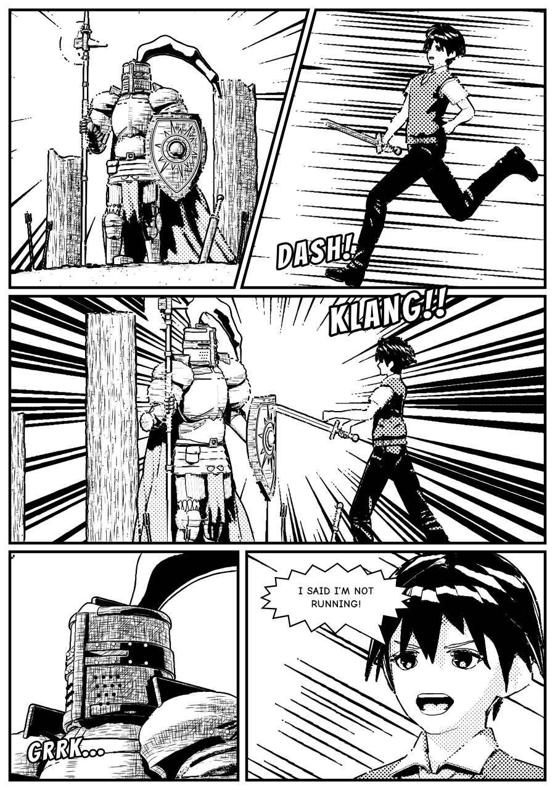
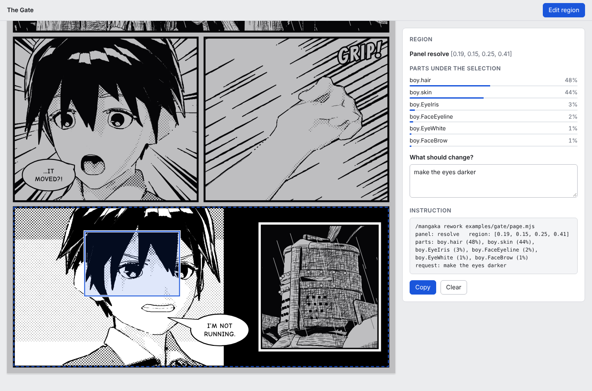
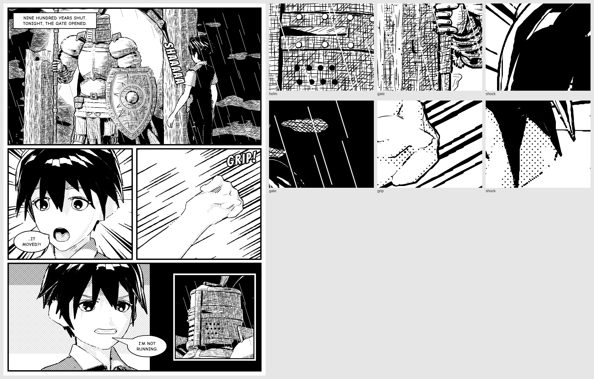

<h1 align="center">mangaka</h1>

<p align="center"><b>An agent skill that builds lettered black-and-white manga pages: the page is built in 3D, then inked.</b><br>For Claude Code, Codex, OpenCode, Antigravity and MiniMax Code. Screentone, solid blacks, hatching, brush outlines, bubbles and sound effects, as one SVG per page.</p>

<p align="center">
  <a href="https://code.claude.com/docs/en/skills"></a>
  <a href="https://agentskills.io"></a>
  <a href="LICENSE"></a>
  <a href="#requirements"></a>
  <a href="#requirements"></a>
  <a href="https://github.com/justinjd00/mangaka/actions/workflows/ci.yml"></a>
</p>

<p align="center">
  <a href="#quick-start">Quick start</a> ·
  <a href="#gallery">Gallery</a> ·
  <a href="#what-it-makes">What it makes</a> ·
  <a href="#install">Install</a> ·
  <a href="#usage">Usage</a> ·
  <a href="#how-it-works">How it works</a> ·
  <a href="#limits">Limits</a>
</p>

<p align="center">
  
</p>

<p align="center"><sub><code>examples/gate</code>: a knight of 82 named code parts in a ruined gate, a boy from a CC0 VRoid model, both in one scene with shared shadows, inked in the <code>seinen-dense</code> style.</sub></p>

---

Ask your agent for a manga page and mangaka has it write the page as a small 3D set instead of drawing it: a scene built from code (armour, weapons, walls, railings, props), anime characters from VRM models posed by bone and given expressions, and one camera per panel. A zero-dependency Node kit renders each panel and traces it into vector ink by rule: screentone in two densities, solid blacks, hatching that follows the form, pressure-varying brush outlines, hair with a shine band. Then it letters the page with bubbles, captions and sound effects measured against the real fonts.

Because every panel is a camera on the same scene, a character keeps her face, hair and clothes from every angle and a sword stays in the hand that holds it. Because every pixel knows which named part it came from, the reader can drag a rectangle over any spot in the viewer, say what should change, and the agent changes only that spot: every other panel comes back byte-identical from the cache, and a diff script proves that no stroke outside the region moved.

## Quick start

```sh
npx skills add justinjd00/mangaka -g
```

The CLI asks which agents to set up (Claude Code, Codex, OpenCode, Antigravity, MiniMax Code). To skip the question, add `-a claude-code`, `-a codex`, `-a opencode`, `-a antigravity` or `-a minimax-code`.

Then, in Claude Code:

```text
/mangaka a quiet page: two classmates on the school roof after class, she tells him she is moving away
```

OpenCode, Antigravity and MiniMax Code take the same `/mangaka` command; in Codex, type `$mangaka`.

No API keys and nothing to `npm install`: the kit uses only Node's built-in modules. Chrome or Chromium is needed for the screenshot checks.

## Gallery

<table>
  <tr>
    <td width="50%"></td>
    <td width="50%"></td>
  </tr>
  <tr>
    <td><sub><b>rooftop</b>: a dialogue page in <code>tone-soft</code>. Two VRM characters on a roof built from the parts library, an establishing shot, two singles, an over-the-shoulder shot and a silent close-up.</sub></td>
    <td><sub><b>duel</b>: an action page in <code>shonen-clean</code>. Diagonal panels with clip polygons, a sword attached to the boy's hand bone so it follows his pose, speed and focus lines.</sub></td>
  </tr>
  <tr>
    <td></td>
    <td></td>
  </tr>
  <tr>
    <td><sub><b>The viewer</b>: every build writes <code>page.html</code>. In edit mode the reader drags a rectangle, types a request and copies an instruction that names the panel, the region and the parts under it.</sub></td>
    <td><sub><b>The contact sheet</b> from <code>scripts/sheet.mjs</code>: the page plus 3x close-ups of its densest regions, so the agent reads the whole page and its ink in one image.</sub></td>
  </tr>
</table>

The pages are the committed examples in [`examples/`](examples) at 1x, captured with the skill's own [`scripts/capture.mjs`](scripts/capture.mjs); the contact sheet comes from [`scripts/sheet.mjs`](scripts/sheet.mjs), and the viewer shot is `examples/gate/page.html#select=180,950,220,150&request=make%20the%20eyes%20darker` in Chrome. Open any `page.html` in `examples/` to read the page and try the edit mode.

## What it makes

| | What you get | Example |
|---|---|---|
| **A panel** | One panel with one or two characters and a set, as `page.svg` plus the viewer. | any panel of the examples on its own, such as `shock` in `gate` |
| **A page** | Four to seven panels, insets or diagonal cuts, lettered in reading order (right to left by default). | `rooftop`, `gate`, `duel` |
| **A rework** | One region of a finished page changed on request, with a diff proving nothing outside it moved. | see [`references/rework.md`](references/rework.md) |

Each page is a folder with the page file the agent wrote (`page.mjs`, plain JavaScript you own), `page.svg` (standalone, fonts embedded, under 2 MB), `page.html` (the viewer), `page.map.json` (which part is where) and `page.stats.json` (tone balance per panel).

Three ink styles ship: `seinen-dense` (heavy hatching, few tones), `shonen-clean` (open whites, strong blacks, tone for greys) and `tone-soft` (mostly screentone). Characters can be the two bundled CC0 models or your own VRoid characters.

## Install

mangaka is a standard [Agent Skill](https://agentskills.io): a folder with a `SKILL.md` at its root. This repository is that folder.

| | Command | Installs to |
|---|---|---|
| **skills CLI**, for you (Claude Code) | `npx skills add justinjd00/mangaka -g -a claude-code` | `~/.claude/skills/mangaka` |
| **skills CLI**, for you (Codex) | `npx skills add justinjd00/mangaka -g -a codex` | `~/.agents/skills/mangaka` |
| **skills CLI**, for you (OpenCode) | `npx skills add justinjd00/mangaka -g -a opencode` | `~/.config/opencode/skills/mangaka` |
| **skills CLI**, for you (Antigravity) | `npx skills add justinjd00/mangaka -g -a antigravity` | `~/.gemini/antigravity/skills/mangaka` |
| **skills CLI**, for you (MiniMax Code) | `npx skills add justinjd00/mangaka -g -a minimax-code` | `~/.minimax/skills/mangaka` |
| **skills CLI**, for one project | `npx skills add justinjd00/mangaka` | `.claude/skills/mangaka` for Claude Code, `.agents/skills/mangaka` for Codex, OpenCode and Antigravity, `.minimax/skills/mangaka` for MiniMax Code |
| **git**, for you (Claude Code) | `git clone https://github.com/justinjd00/mangaka.git ~/.claude/skills/mangaka` | `~/.claude/skills/mangaka` |
| **git**, for you (Codex) | `git clone https://github.com/justinjd00/mangaka.git ~/.agents/skills/mangaka` | `~/.agents/skills/mangaka` |
| **git**, for you (OpenCode) | `git clone https://github.com/justinjd00/mangaka.git ~/.config/opencode/skills/mangaka` | `~/.config/opencode/skills/mangaka` |
| **git**, for you (Antigravity) | `git clone https://github.com/justinjd00/mangaka.git ~/.gemini/antigravity/skills/mangaka` | `~/.gemini/antigravity/skills/mangaka` |
| **git**, for you (MiniMax Code) | `git clone https://github.com/justinjd00/mangaka.git ~/.minimax/skills/mangaka` | `~/.minimax/skills/mangaka` |
| **Download**, no git | see below | any of the folders above |

<details>
<summary><b>With the skills CLI</b></summary>

<br>

The [`skills`](https://github.com/vercel-labs/skills) CLI finds the `SKILL.md` at the root of this repository and installs it as `mangaka`. By default it installs into the current project and asks which agents to set up; `-g` installs it for your user, and `-a` picks one agent. The CLI copies the whole repository, including the two bundled models and the built examples (about 40 MB).

</details>

<details>
<summary><b>With git</b></summary>

<br>

Clone the repository into a skills folder so that `SKILL.md` ends up at `<skills folder>/mangaka/SKILL.md`. For a project install, clone into `.claude/skills/mangaka` (Claude Code), `.agents/skills/mangaka` (Codex, OpenCode, Antigravity) or `.minimax/skills/mangaka` (MiniMax Code), and commit it so your team gets it too. To update, run `git pull` inside that folder.

</details>

<details>
<summary><b>Download, without git</b></summary>

<br>

[Download the ZIP](https://github.com/justinjd00/mangaka/archive/refs/heads/main.zip), unpack it, rename the folder from `mangaka-main` to `mangaka`, and move it into `~/.claude/skills/` (Claude Code), `~/.agents/skills/` (Codex), `~/.config/opencode/skills/` (OpenCode), `~/.gemini/antigravity/skills/` (Antigravity) or `~/.minimax/skills/` (MiniMax Code).

On macOS or Linux, in one line (change the target folder for another agent):

```sh
mkdir -p ~/.claude/skills/mangaka && curl -L https://github.com/justinjd00/mangaka/archive/refs/heads/main.tar.gz | tar -xz --strip-components=1 -C ~/.claude/skills/mangaka
```

</details>

Claude Code picks up new skills in a running session; if the `skills` folder did not exist when the session started, restart it. Codex lists the skill under `/skills` and runs it with `$mangaka`. OpenCode, Antigravity and MiniMax Code list it as `/mangaka`; restart the agent if it does not show.

<details>
<summary><b>Codex: if the screenshot checks are blocked</b></summary>

<br>

The checks start headless Chrome, which Codex's sandbox may stop. The page is still built and `check.mjs` still runs; only the screenshots fail. Approve the command when Codex asks to run it outside the sandbox, or run it yourself in a normal terminal, for example `node scripts/capture.mjs examples/rooftop --out shots`.

</details>

## Usage

Type `/mangaka` (in Codex, `$mangaka`) and describe the scene:

```text
/mangaka a quiet page: two classmates on the school roof after class, she tells him she is moving away
```

You do not have to name the skill. Your agent also loads it when you ask for a manga page, a comic page, a manga panel, a storyboard, a character scene, or a black-and-white ink illustration of a character.

<details>
<summary><b>More prompts</b>, from the skill's <a href="evals/evals.json">evals</a></summary>

<br>

```text
/mangaka a single wide panel: a girl alone on a park bench at night under a lantern, looking down at her phone, sad
```

```text
/mangaka a full page, right to left: two friends meet at a train platform after years apart, one doesn't recognise the other at first
```

```text
/mangaka here's my own character, made in VRoid: ./models/aoi.vrm. Two panels: she walks into a classroom and waves.
```

```text
/mangaka action page: a boy with a sword charges an armoured knight, the knight blocks with his shield. Make it feel fast.
```

</details>

Habits that get the best pages:

1. **Give the beat, not the drawing.** Say what happens and what it should feel like. The agent writes the panel script first and shows it to you; adjust it there, before anything is built.
2. **Bring your characters.** Make them in [VRoid Studio](https://vroid.com/en/studio), export as VRM 0.x, and give the agent the file. It checks the licence in the file's metadata first.
3. **Point at what to change.** Open `page.html`, press **Edit region**, drag over the spot, type the change and paste the copied instruction into the chat. The agent changes that region only and shows you the diff result.

## How it works

- **[`SKILL.md`](SKILL.md)** is what the agent reads: size the job, write the script first, cast and set, block the scene, choose shots, build, direct the ink, letter, verify like an editor, rework. It holds the craft rules in short form.
- **[`kit/`](kit)** is the engine. `sdf.mjs` describes forms as distance fields with plain-data descriptions; `parts/` is a library of armour, weapons, architecture and props; `vrm.mjs` loads and poses VRM models in pure Node; `shade.mjs` renders forms and characters into one z-buffer with one shadow map; `ink.mjs` traces the result into screentone, blacks, hatching and brush outlines; `lettering.mjs` sets bubbles, captions and sound effects with the real font metrics; `page.mjs` assembles the page, writes the viewer and caches each panel by a hash of everything that reaches its ink.
- **Determinism.** Every random choice is seeded from stable keys (panel id, part name, layer, screen cell). The same page file builds to the same bytes on any machine, and a change in one place cannot reshuffle ink elsewhere. That is what makes a region rework provable.
- **[`references/`](references)** are the long-form guides the agent opens when it needs them: the kit API, characters, ink, layout, lettering, rework, verification, craft and a walkthrough of one page.
- **Verification.** [`scripts/check.mjs`](scripts/check.mjs) checks tone balance per panel, the size budget, lettering inside its panel, bubble order and (with `--page`) that two builds give the same bytes. [`scripts/capture.mjs`](scripts/capture.mjs) and [`scripts/sheet.mjs`](scripts/sheet.mjs) take Chrome screenshots, close-ups and a contact sheet. [`scripts/rework.mjs`](scripts/rework.mjs) and [`scripts/diff.mjs`](scripts/diff.mjs) rebuild one panel and prove every changed stroke lies inside the region. The skill tells the agent to read every PNG it makes.

<details>
<summary><b>Repository layout</b></summary>

<br>

```text
mangaka/
├── SKILL.md                 the skill: workflow, setup, craft rules, rework, limits
├── kit/                     the engine, Node built-ins only
│   ├── page.mjs             page spec, build, panel cache, map
│   ├── sdf.mjs              forms, operations, scene()
│   ├── parts/               armor, weapons, architecture, props, util
│   ├── attach.mjs           props on bones and frames
│   ├── vrm.mjs, png.mjs     VRM 0.x loader and posing, PNG decoder
│   ├── poses.mjs            pose and hand-shape library
│   ├── raster.mjs, mesh.mjs, shade.mjs, materials.mjs
│   │                        cameras, distance-field and triangle rasters, tone per material
│   ├── ink.mjs, styles.mjs  the inker and its three styles
│   ├── lettering.mjs        bubbles, captions, sound effects, font metrics
│   ├── backgrounds.mjs, effects.mjs
│   ├── viewer.mjs, viewer-core.mjs
│   ├── rng.mjs              seeded randomness
│   └── fonts/               Comic Neue and Bangers, with licences
├── references/              craft, kit, characters, ink, layout, lettering, rework, verify, walkthrough
├── scripts/                 build, check, capture, sheet, rework, diff, fingerprint, chrome
├── models/                  two CC0 VRoid models and their licence note
├── examples/                gate, rooftop, duel: page files and committed output
├── tests/                   node:test unit tests
├── evals/evals.json         test prompts and what a good answer contains
├── agents/openai.yaml
└── .github/                 CI, issue forms, PR template, README images
```

</details>

## Requirements

| | Needed for | Notes |
|---|---|---|
| **[Claude Code](https://code.claude.com/docs/en/overview)**, or [Codex](https://developers.openai.com/codex/skills), [OpenCode](https://opencode.ai/docs/skills/), [Antigravity](https://antigravity.google) or [MiniMax Code](https://github.com/MiniMax-AI/minimax-code) | everything | The skill is written for Claude Code and follows the open Agent Skills format. |
| **Node.js 20.10+** | builds, kit, checks | Built-in modules only. CI builds the examples on Node 20 and 22. |
| **Chrome or Chromium** | screenshots and contact sheets | Found in the usual places on Linux, macOS and Windows; set `CHROME_PATH` for any other binary. Builds and `check.mjs` work without it. |

A cold build takes about 10 to 20 seconds per panel on one core (the five-panel rooftop page about 75 seconds). Unchanged panels come from the cache at once, so a rework costs one panel's build.

## Limits

- **The look is clean anime characters inked by rule, not a master's hand-drawn line.** Every stroke is placed by rule on top of modelled shapes. The pages are clean, consistent and fully lettered; they do not have the intent of a line drawn by a mangaka's hand, and faces read as their VRM models do.
- **Black and white only, for now.** Colour, the manhwa scroll format, motion pages and real-time 3D are planned for later versions.
- **Characters come from VRM models, so variety depends on the models you bring.** The two bundled models share the VRoid family look. Version 1 reads VRM 0.x only.
- **Not proved yet:** two characters in physical contact, crowds, interiors and long cloth. The examples show standing, walking, running, a sword strike and close-ups.
- **The camera is orthographic.** There is no perspective foreshortening; distant things are built small.
- **It is not fast.** Seconds per panel, not milliseconds, and no parallel rendering yet.

## Credits

- **Models.** `models/fumiriya.vrm` (Sakurada Fumiriya) and `models/shino.vrm` (Sendagaya Shino) are VRoid Studio sample models from the `vroid/beta` folder of [madjin/vrm-samples](https://github.com/madjin/vrm-samples), unmodified. Each file's own metadata gives the licence as CC0; see [`models/README.md`](models/README.md).
- **Fonts.** [Comic Neue](https://github.com/crozynski/comicneue) (dialogue and captions) and [Bangers](https://github.com/googlefonts/bangers) (sound effects), both under the SIL Open Font License 1.1, from their Fontsource packages; see [`kit/fonts/README.md`](kit/fonts/README.md).
- **Structure.** The repository's structure (a skill with a kit, references, scripts, examples and evals) is inspired by [wheresryan22/anatomy](https://github.com/wheresryan22/anatomy).

## Contributing

Issues and pull requests are welcome. Read [CONTRIBUTING.md](CONTRIBUTING.md) first: it covers building the examples, running the tests and checks, and the house rules (zero dependencies, determinism, original characters only, CC0 models only, examples must pass `check.mjs`). Please follow the [Code of Conduct](CODE_OF_CONDUCT.md), and report security problems as described in [SECURITY.md](SECURITY.md).

- [Report a bug](https://github.com/justinjd00/mangaka/issues/new?template=bug_report.yml)
- [Request a page or feature](https://github.com/justinjd00/mangaka/issues/new?template=page_request.yml)
- [Changelog](CHANGELOG.md)

## License

[MIT](LICENSE) © 2026 justinjd00. The bundled models are CC0 and the fonts are under the SIL Open Font License 1.1.
